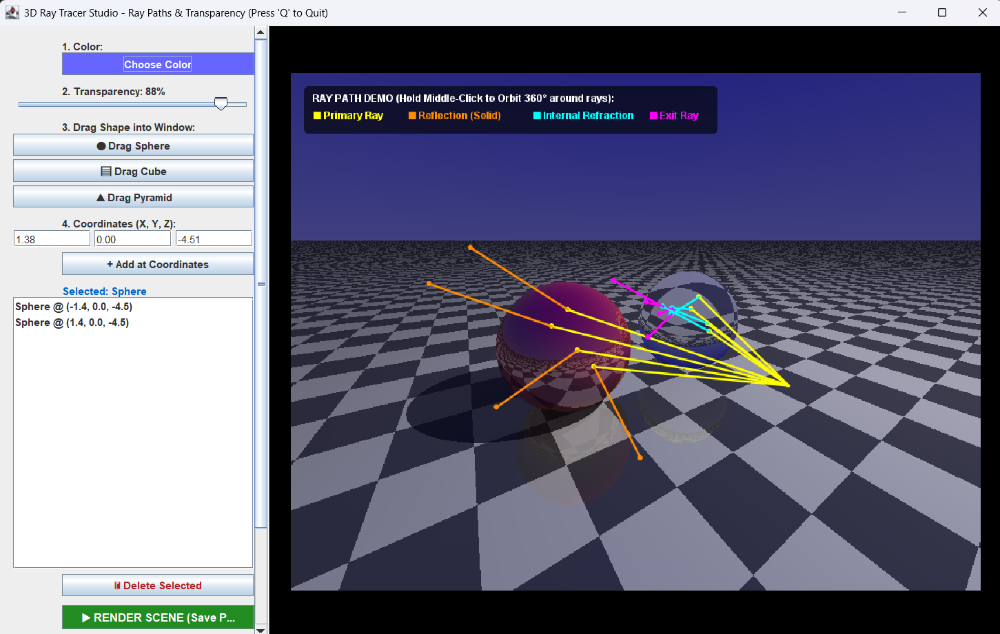
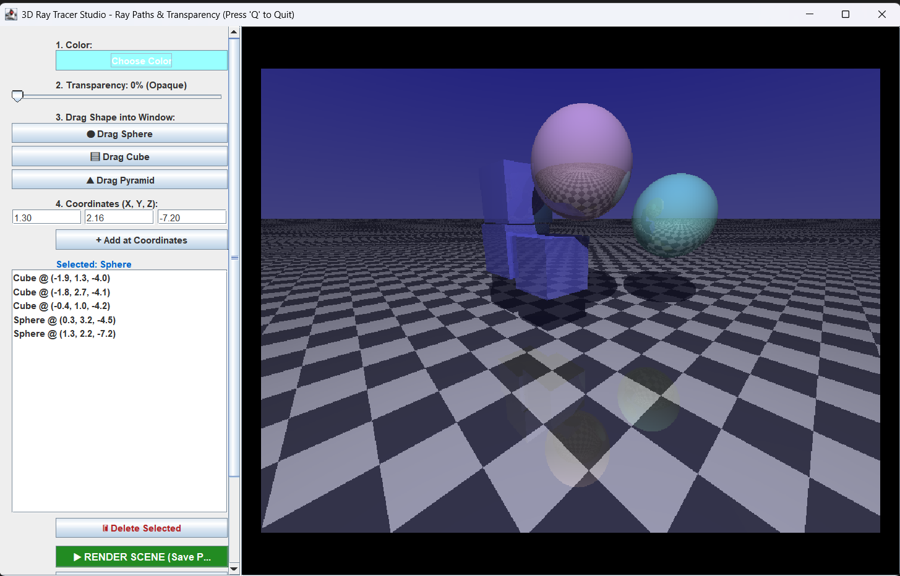
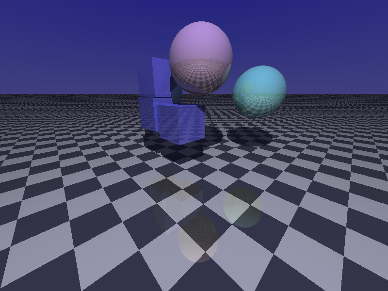

# Ray Tracer using JAVA

An interactive 3D ray tracer written in plain Java (Swing + AWT, no external
libraries). Build a scene by dragging spheres, cubes and pyramids into the
viewport, set each object's color and transparency, orbit the camera
around the scene, and export the final render as a PNG. A built-in **Ray Path
Demo** draws the actual primary, reflected and refracted rays on top of the
render so you can see how a ray tracer works.



---

## Features

- **Three primitives + floor:** sphere, axis-aligned cube, square pyramid,
  and an infinite checkered floor plane.
- **Drag-and-drop scene editing:** drag a shape from the sidebar into the
  viewport, click an object to select it, drag it to move it, scroll over it to
  push it nearer or farther.
- **Per-object materials:** color picker and a 0–100% transparency slider.
- **Lighting:** a point light with Lambertian (diffuse) shading, ambient light
  and hard shadows. Objects with transparency ≥ 50% do not cast shadows.
- **Reflection:** recursive mirror reflection, blended by each object's
  reflectivity.
- **Refraction:** glass-like transparency using Snell's law (index of
  refraction 1.5), including total internal reflection.
- **360° orbit camera:** middle-click drag (or Alt + left-drag) to orbit, and
  the mouse wheel to zoom.
- **Fast preview while editing:** low-resolution, single-bounce preview while
  dragging. The full-quality render runs when you release the mouse.
- **Multithreaded rendering:** image rows are traced in parallel with
  `IntStream.parallel()`.
- **PNG export:** **RENDER SCENE (Save PNG)** writes `rendered_scene.png`.
- **Ray Path Demo:** a red reflective sphere and a clear glass sphere with
  color-coded ray paths drawn over the render.

## Screenshots

### Scene editor: opaque and transparent objects

Cubes and spheres at different transparency levels, with reflections in the
checkered floor and shadows cast by the light.



### Exported render (`rendered_scene.png`)

The 800×600 image saved by **RENDER SCENE (Save PNG)**.



### Ray path demo

| Color   | Meaning                                                  |
|---------|----------------------------------------------------------|
| Yellow  | Primary ray from the camera to the surface               |
| Orange  | Reflected ray bouncing off the solid (red) sphere        |
| Cyan    | Refracted ray traveling *inside* the glass sphere        |
| Magenta | Ray leaving the glass sphere after the second refraction |

Hold the middle mouse button and drag to orbit around the rays in 3D.

---

## Requirements

- JDK 11 or newer (developed and tested with a recent JDK; uses only the
  standard library).

## Build and run

From the project root:

```bash
cd demo_ray
javac -encoding UTF-8 RayTracer_with_GUI.java
java RayTracer_with_GUI
```

`-encoding UTF-8` is needed because the button labels contain Unicode symbols.
Exported images are saved as `rendered_scene.png` in the directory you ran
the program from.

## Controls

| Action                               | How                                                          |
|--------------------------------------|--------------------------------------------------------------|
| Add a shape                          | Press **Drag Sphere / Cube / Pyramid**, then drag into the viewport |
| Add a sphere at exact coordinates    | Enter X, Y, Z → **+ Add at Coordinates**                     |
| Select an object                     | Left-click it in the viewport, or click it in the object list |
| Move an object                       | Left-click and drag it (moves parallel to the screen)       |
| Move an object nearer / farther      | Mouse wheel while hovering over it                           |
| Zoom the camera                      | Mouse wheel over empty space / floor                         |
| Orbit the camera 360°                | Middle-click drag, or **Alt + left-drag**                    |
| Change color / transparency          | **Choose Color** and the **Transparency** slider (applies to the selected object and to new ones) |
| Delete an object                     | Select it → **Delete Selected**                              |
| Render and save PNG                  | **RENDER SCENE (Save PNG)**                                  |
| Reset camera                         | **Reset Camera (0°)**                                        |
| Remove all objects                   | **Clear All**                                                |
| Show ray paths                       | **RAY TRACER DEMO (Rays Path)**                              |
| Quit                                 | Press **Q** or click **Quit**                                |

---

## How it works

For every pixel the program shoots a ray from the camera through that pixel
and calls `trace()` recursively:

1. **Closest hit:** test the ray against every object and keep the nearest
   intersection (`findClosestHit`).
2. **Sky:** if nothing is hit, return a blue gradient based on the ray's
   height.
3. **Shadow ray:** cast a ray toward the light. If an opaque object blocks
   it, only ambient light (0.2) is applied. Otherwise diffuse light
   `0.8 · max(0, N·L)` is added.
4. **Reflection:** if the object is reflective, trace
   `R = D − 2(D·N)N` and blend it in by `reflectivity`.
5. **Refraction:** if the object is transparent, bend the ray with Snell's law
   (`η = n₁/n₂`, IOR 1.5). The normal and IOR are flipped when the ray exits
   the object, and the ray is reflected when total internal reflection occurs.
   The result is blended in by `transparency`.
6. Recursion stops at `MAX_DEPTH = 4`.

### Intersection algorithms

| Shape   | Method                                                              |
|---------|---------------------------------------------------------------------|
| Sphere  | Solves the quadratic `|O + tD − C|² = r²`                           |
| Cube    | Slab method for axis-aligned bounding boxes                        |
| Pyramid | Möller–Trumbore ray/triangle test on 6 triangles (4 sides + base)   |
| Plane   | `t = ((P₀ − O)·N) / (D·N)`, with a checkerboard pattern from `floor(x) xor floor(z)` |

### Code structure (`demo_ray/RayTracer_with_GUI.java`)

| Class / method                | Responsibility                                            |
|-------------------------------|-----------------------------------------------------------|
| `Vector3`                     | 3D vector math (add, sub, mult, dot, cross, normalize)   |
| `Ray`                         | Origin + normalized direction                             |
| `SceneObject` (abstract)      | Color, reflectivity, transparency, IOR, intersection API  |
| `Sphere`, `Cube`, `Pyramid`, `Plane` | Concrete shapes                                    |
| `HitRecord`, `findClosestHit` | Nearest-intersection search                               |
| `trace`                       | Recursive shading: shadows, reflection, refraction        |
| `renderScene`                 | Parallel per-pixel render loop and demo overlay           |
| `getCameraPosition`, `getRayFromPixel`, `projectToScreen` | Orbit camera, pixel ↔ world mapping |
| `setupMouseInteractions`      | Picking, dragging, orbiting, zooming                      |
| `setupRayTracerDemo`, `generateDemoRayPaths` | Ray Path Demo scene and ray segments       |

---

## Project layout

```
java_cbp/
├── demo_ray/
│   ├── RayTracer_with_GUI.java   ← main interactive application
│   ├── RayTracer2.java           ← console version: spheres + plane with reflections
│   └── SimpleRayTracer.java      ← minimal first version: a single sphere
├── src/                          ← modular, non-GUI ray tracer (see below)
├── docs/images/                  ← screenshots used in this README
├── REPORT.md                     ← full project report
├── Ray_Tracing_Presentation.pptx ← project presentation
├── output.png                    ← output of the src/ ray tracer
└── rendered_scene.png            ← output of the GUI ray tracer
```

### Modular command-line version (`src/`)

`src/` contains an earlier, non-interactive ray tracer split into one class
per file (`Vec3`, `Ray`, `Material`, `Hittable`, `Sphere`, `Plane`, `Light`,
`Scene`, `Camera`, `RayTracer`). It adds Blinn-Phong specular highlights,
multiple lights and jittered anti-aliasing, and writes `output.png`:

```bash
javac -d out src/*.java
java -cp out RayTracer
```

Resolution, samples per pixel, reflection depth and the scene itself are set
at the top of `src/RayTracer.java` (`IMAGE_WIDTH`, `IMAGE_HEIGHT`,
`SAMPLES_PER_PIXEL`, `MAX_REFLECTION_DEPTH`, `buildScene()`).

---

## Tweaking the GUI version

Constants at the top of `RayTracer_with_GUI.java`:

- `RENDER_WIDTH`, `RENDER_HEIGHT`: viewport and PNG resolution (default 800×600).
- `MAX_DEPTH`: maximum reflection/refraction bounces (default 4).

Light position: `lightPos` in `renderScene()`. Default sizes, reflectivity and
other material values for new shapes: `createShape()`.

## Possible extensions

- Fresnel (Schlick) blending between reflection and refraction
- Anti-aliasing (multi-sampling) and Blinn-Phong specular in the GUI version
- Soft shadows from area lights, and multiple lights
- Rotatable or scalable objects, and triangle-mesh (OBJ) import
- Shape choice for **Add at Coordinates** (it currently always adds a sphere)
- A BVH acceleration structure for scenes with many objects
